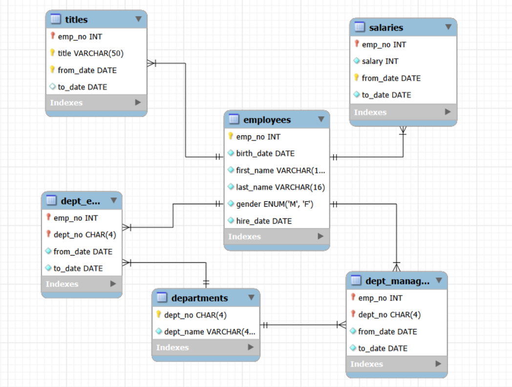
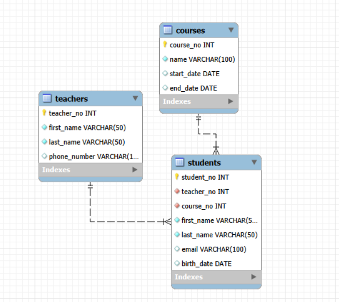

🌐 **Language:** [Українська](README.ua.md) | English

# 🗄️ SQL HR Analytics and Database Design (MySQL)

## 📌 Project Overview
This repository demonstrates two core competencies of a Data Analyst:
1. **Analytical Querying (DQL):** Extracting actionable HR and payroll insights from a large corporate database (`employees`).
2. **Relational Database Architecture (DDL/DML & Data Quality):** Designing a normalized database schema from scratch (`course_management`), managing transactional data, and auditing records for duplicates.

---

## 📊 Part 1: HR & Compensation Analytics (`01_hr_compensation_analysis.sql`)

### Database Schema (`employees`)
Analyzed a multi-table relational database tracking employee demographics, historical salary contracts, department assignments, and managerial tenures.

### Key Business Questions Solved
* **Historical Payroll Trends:** Calculated year-over-year average salary dynamics prior to 2005.
* **Departmental Benchmarks:** Evaluated current active salaries across all departments using `CTEs` and temporary tables.
* **Cross-Departmental Pivot Matrix:** Built a dynamic yearly salary comparison across 9 departments using conditional aggregation (`SUM(IF(...))`).
* **Headcount Capacity Audit:** Identified high-capacity departments exceeding 15,000 active employees (`GROUP BY` + `HAVING`).
* **Tenure & Succession Tracking:** Determined the longest-serving active manager and audited leadership succession (2nd manager per department) using Window Functions (`ROW_NUMBER() OVER(PARTITION BY ...)`).
* **Compensation Outliers:** Pinpointed the top 10 active employees with the largest salary deviation from their departmental average.

---

## 🏗️ Part 2: EdTech Database Design & Data Quality (`02_edtech_database_design.sql`)

### Database Schema (`course_management`)
Designed a normalized 3-table relational schema (`teachers`, `courses`, `students`) enforcing referential integrity (`PRIMARY KEY`, `FOREIGN KEY`) and business logic (`CHECK` constraints on course dates).

### Key Tasks Implemented
* **Schema Architecture (DDL):** Created normalized tables with auto-incrementing keys, foreign key relationships, and date validation rules.
* **Transactional Ingestion (DML):** Populated tables within an atomic `START TRANSACTION ... COMMIT` block to ensure data consistency.
* **Instructor Workload Reporting:** Aggregated active student counts per instructor using `INNER JOIN` and `GROUP BY`.
* **Duplicate Detection Audit:** Simulated duplicate student enrollments and wrote a deduplication audit query (`GROUP BY` + `HAVING COUNT(*) > 1` + `GROUP_CONCAT`) to flag conflicting primary keys.

---

## 🛠️ SQL Skills Demonstrated
* **Querying & Analytics:** `CTEs (WITH)`, Window Functions (`ROW_NUMBER`), Conditional Aggregation (Pivot), `INNER JOIN`, `GROUP BY`, `HAVING`, Date Math (`CURDATE()`, `TIMESTAMPDIFF()`).
* **Database Engineering:** `CREATE DATABASE/TABLE`, `PRIMARY/FOREIGN KEYS`, `CHECK` constraints, Temporary Tables, Transactions (`COMMIT`), Data Quality / Deduplication.

## 📂 Repository Structure
* `01_hr_compensation_analysis.sql` — Analytical queries with business questions and sample output previews.
* `02_edtech_database_design.sql` — DDL/DML scripts, reporting, and duplicate audit queries.
* `images/` — ER diagrams (`erd_employees.png`, `erd_course_management.png`).
* `README.md`, `README.ua.md` — Project documentation.
