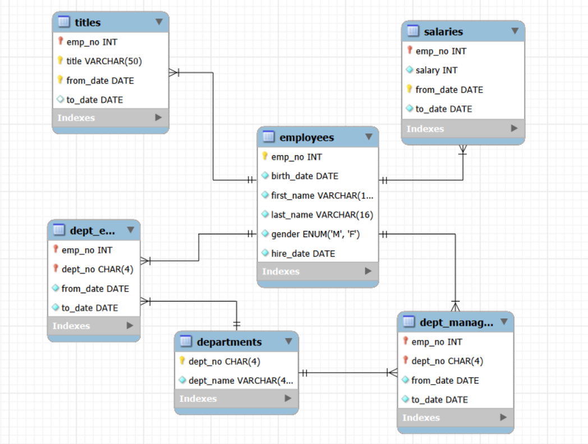
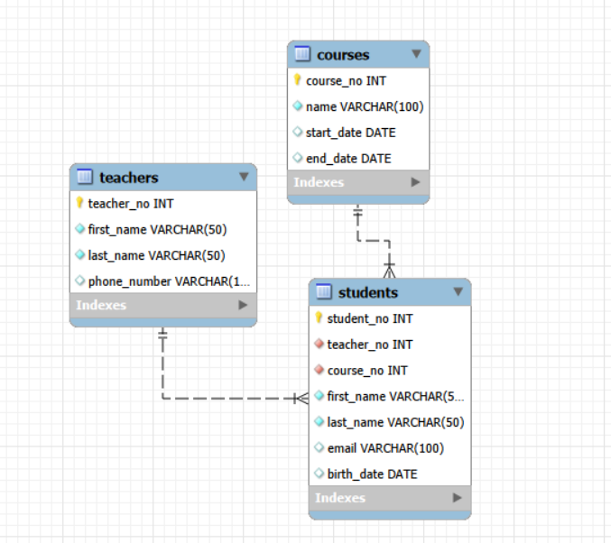

🌐 **Мова:** [English](README.md) | Українська

# 🗄️ SQL HR Analytics and Database Design (MySQL)

## 📌 Огляд проєкту
Цей репозиторій демонструє дві ключові компетенції Data Analyst при роботі з реляційними базами даних:
1. **Аналітичні SQL-запити (DQL):** Пошук бізнес-інсайтів щодо фонду оплати праці, структури персоналу та спадкоємності керівництва на основі великої корпоративної бази даних (`employees`).
2. **Проєктування баз даних та Data Quality (DDL/DML):** Розробка нормалізованої схеми БД з нуля (`course_management`), управління транзакціями та аудит якості даних на наявність дублікатів.

---

## 📊 Частина 1: HR та аналітика компенсацій (`01_hr_compensation_analysis.sql`)

### Схема бази даних (`employees`)
Проаналізовано багатотабличну реляційну базу даних, що містить демографічні дані співробітників, історію зарплатних контрактів, розподіл за відділами та періоди роботи менеджерів.

### Вирішені бізнес-задачі та висновки
* **Історична динаміка зарплат:** Розраховано щорічну зміну середньої заробітної плати по компанії до 2005 року — виявлено стабільне щорічне зростання виплат.
* **Бенчмарки по відділах:** Оцінено поточні середні зарплати активних співробітників за допомогою `CTE` та тимчасових таблиць (`TEMPORARY TABLE`). Найвищі середні виплати зафіксовано у відділах Sales (`d007`) та Marketing (`d001`).
* **Зведена матриця зарплат (Pivot):** Побудовано порівняльну таблицю середніх зарплат у розрізі всіх 9 відділів за роками через умовну агрегацію (`SUM(IF(...))`).
* **Аналіз найбільших підрозділів:** Визначено відділи зі штатом понад 15 000 активних співробітників (`GROUP BY` + `HAVING`) — основне операційне навантаження припадає на Production, Development та Sales.
* **Аудит керівного складу та спадкоємності:** Знайдено чинного менеджера з найдовшим стажем у компанії, а також визначено другого менеджера в історії кожного відділу за допомогою віконних функцій (`ROW_NUMBER() OVER(PARTITION BY ...)`).
* **Пошук зарплатних аномалій:** Виявлено топ-10 активних співробітників із найбільшим відхиленням зарплати від середнього показника по їхньому відділу для перевірки бонусних нарахувань або викидів.

---

## 🏗️ Частина 2: Проєктування БД EdTech та контроль якості даних (`02_edtech_database_design.sql`)

### Схема бази даних (`course_management`)
Спроєктовано нормалізовану реляційну модель із 3 пов'язаних таблиць (`teachers`, `courses`, `students`) із забезпеченням цілісності даних (`PRIMARY KEY`, `FOREIGN KEY`) та бізнес-правил валідації дат (`CHECK`).

### Реалізовані етапи
* **Архітектура схеми (DDL):** Створено таблиці з автоінкрементними ключами, зовнішніми ключами та перевіркою коректності дат початку й завершення курсів.
* **Транзакційне наповнення (DML):** Дані завантажено в межах атомарної транзакції (`START TRANSACTION ... COMMIT`) для гарантії цілісності записів.
* **Звітність щодо навантаження викладачів:** Підраховано кількість студентів за кожним викладачем (`INNER JOIN` + `GROUP BY`) для оцінки розподілу навантаження.
* **Аудит дублікатів (Data Quality):** Змодельовано дублювання записів про студентів та написано запит для виявлення дублікатів (`GROUP BY` + `HAVING COUNT(*) > 1` + `GROUP_CONCAT`) з виведенням конфліктуючих ID для безпечного очищення.

---

## 🛠️ Використані інструменти та навички SQL
* **Аналітика та вибірки:** `CTEs (WITH)`, віконні функції (`ROW_NUMBER`), зведена агрегація (Pivot), `INNER JOIN`, `GROUP BY`, `HAVING`, робота з датами (`CURDATE()`, `TIMESTAMPDIFF()`).
* **Інженерія даних:** `CREATE DATABASE/TABLE`, `PRIMARY/FOREIGN KEYS`, обмеження `CHECK`, тимчасові таблиці, транзакції (`COMMIT`), дедуплікація даних.

## 📂 Структура репозиторію
* `01_hr_compensation_analysis.sql` — аналітичні запити з бізнес-питаннями, прикладами виводу та інсайтами.
* `02_edtech_database_design.sql` — DDL/DML-скрипти, звіти та аудит дублікатів.
* `images/` — ER-діаграми баз даних (`erd_employees.png`, `erd_course_management.png`).
* `README.md`, `README.ua.md` — документація проєкту.
